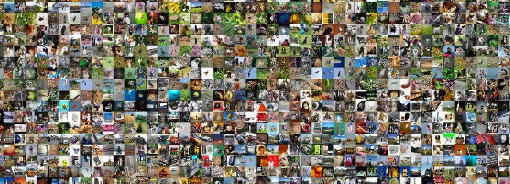
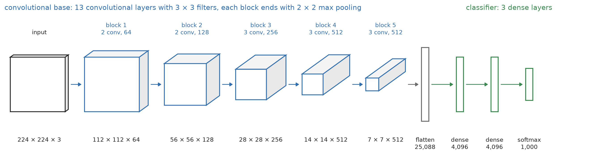
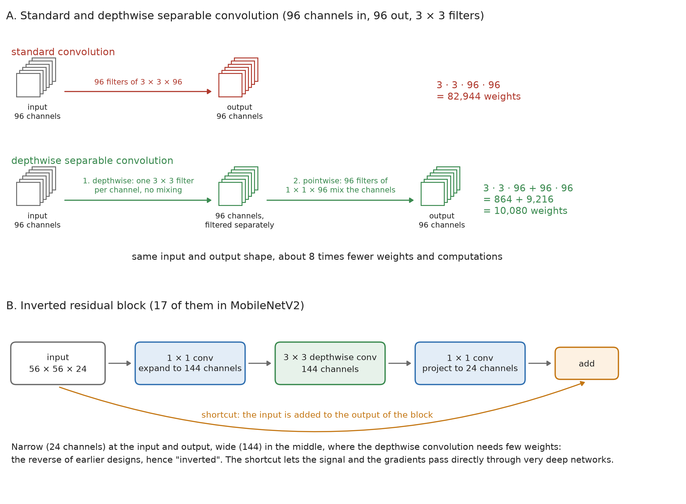
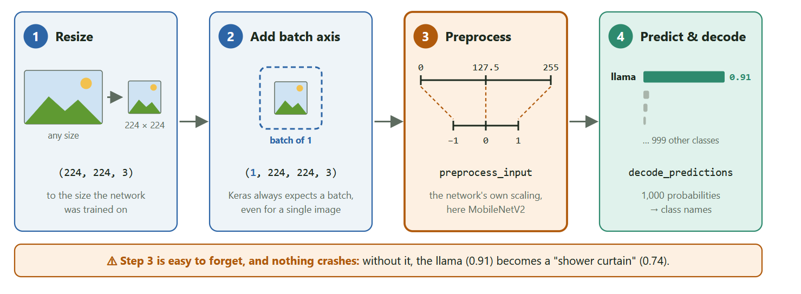
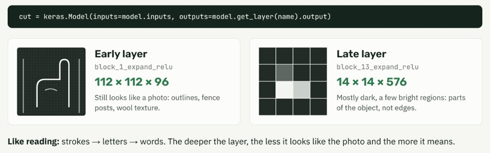
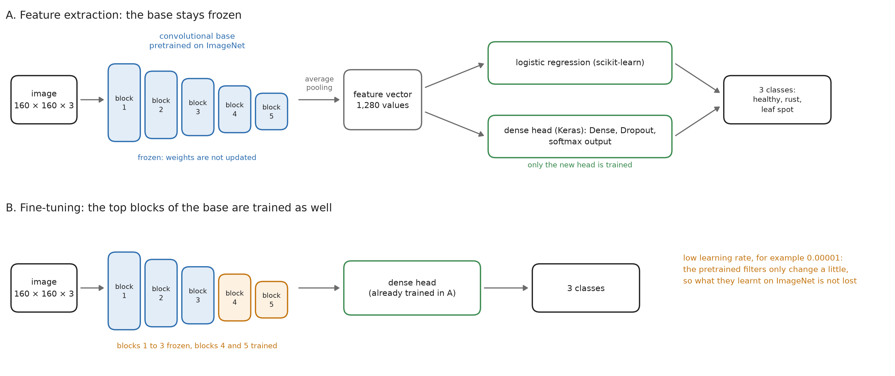
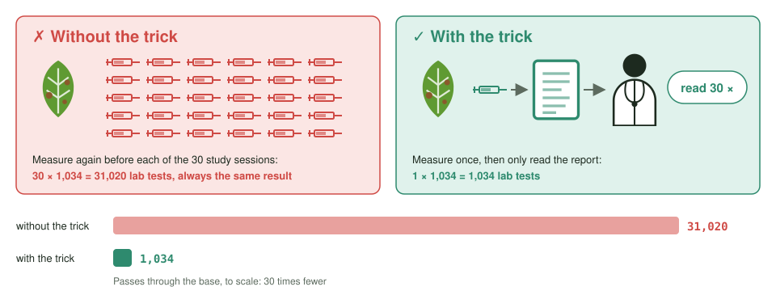
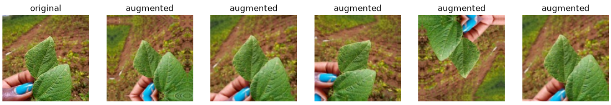
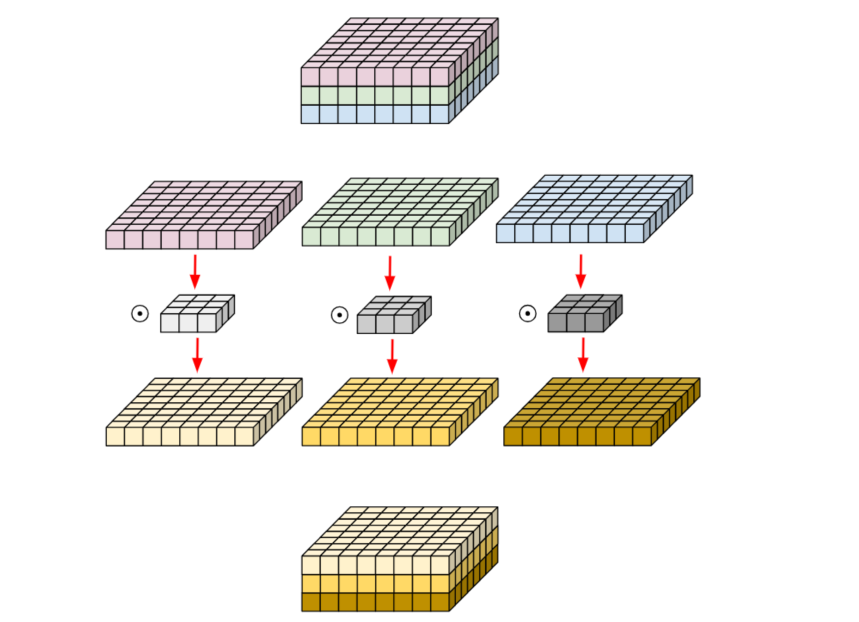

# Summary week 05 day 04

# Pretrained Networks and Transfer Learning

## 1. ImageNet: Where Pretrained Models Come From

**ImageNet** is a collection of millions of labelled photos. Its yearly competition (2010 to 2017) used about **1.2 million training images in 1,000 classes**, from "goldfish" to "umbrella".

In 2011, before CNNs, the best models still missed the correct class in about 26 % of the images (top-5 error). By 2015, CNNs had brought this below 4 %.



The research groups published the networks together with their **learnt weights**. 

Today anyone can download them, for example with [`keras.applications`](https://keras.io/api/applications/), and use them directly:

| Network | Year | Parameters | Idea |
|---|---|---|---|
| VGG16 | 2014 | 138 M | deep stack of 3 × 3 convolutions, large dense layers |
| MobileNetV2 | 2018 | 3.5 M | small and fast, designed for phones |
| EfficientNetB0 | 2019 | 5.3 M | high accuracy per parameter |
|..many more |

---

## 2. Why Not Start From Scratch Every Time?

A CNN starts with random filters. To learn edges, textures and shapes on its own, it needs:


- millions of labelled images
- powerful GPUs
- days or weeks of training

Most real tasks have far fewer images: a few hundred photos of plant diseases, sea animals or industrial defects.

But a network trained on ImageNet has already learnt to recognise edges, textures, shapes and object parts. These visual concepts are useful for almost every image problem --> reuse them

This idea is called **transfer learning**: a model trained for one task becomes the starting point for a related task.

> **Analogy:** someone who already speaks five languages learns a sixth much faster than a child learns its first. A pretrained CNN has already learnt how to *see*. We only need to teach it a new task.

---

## 3. VGG16 and MobileNetV2


<sub>black = input · blue = conv base · grey = Flatten · green = dense classifier</sub>

**VGG16** is the classic deep CNN: 13 convolutional layers in five blocks, then `Flatten` and three large dense layers.

Its weakness is the end. `Flatten` turns the last 7 × 7 × 512 feature maps into 25,088 values, and every one of them is connected to each of 4,096 neurons. This single dense layer holds **74 % of all 138 million parameters**. The 13 convolutional layers, which actually find the features, hold only 11 %.

> **Analogy:** VGG16 is like a company with 13 departments that do the real work, each using the same simple method: looking at small 3 × 3 patches. At the end sits a board of 4,096 members, and every member reads all 25,088 individual notes instead of a summary. That board meeting eats 74 % of the budget. 
--> MobileNetV2 is the lean company: each department sends up one number, and a single person decides.
 
---


**MobileNetV2** reaches a similar accuracy with **3.5 million parameters, 39 times fewer**, thanks to three ideas:


1. **Depthwise separable convolution.** A standard convolution filters in space and mixes the channels in one step. MobileNet splits this: first each channel is filtered on its own (depthwise), then the channels are mixed pixel by pixel (pointwise 1 × 1). For 96 channels this needs about **8 times fewer** parameters.
   > **Analogy:** a recording studio with 96 tracks and 96 mixes. Instead of re-equalising every track for every mix, you equalise each track once and then only set its volume in each mix.
2. **Inverted residual blocks.** Each block expands the channels (24 → 144), filters them cheaply and compresses them again (→ 24). A **shortcut** adds the input to the output, so information and gradients pass straight through the deep network.
   > **Analogy:** packing a suitcase. You unpack it onto the bed (expand 24 → 144), sort through each item on its own (cheap depthwise filtering) and pack it back into the small suitcase (compress → 24). Only the small suitcase travels. Keeping old packing list and only adding the changes, so nothing gets lost.
3. **Global average pooling instead of large dense layers.** Each of the 1,280 final feature maps is averaged to one number, followed by a single dense layer.
   > **Analogy:** remember the expensive board meeting in VGG16, where 4,096 members read all 25,088 individual notes? MobileNetV2 replaces it with a one-page summary: each of the 1,280 departments sends up a single number, its average result, and one decision-maker picks the class.


<sub>A: red = standard conv · green = depthwise separable — B: blue = 1 × 1 conv · green = depthwise conv · orange = shortcut</sub>


---

## 4. Classifying a Photo in Four Steps

1. **Resize** the photo to the size the network was trained on, for example 224 × 224.
2. **Add a batch axis:** Keras always expects a batch, even for a single image, shape `(1, 224, 224, 3)`.
3. **Preprocess** with the network's own `preprocess_input`, for MobileNetV2 from 0…255 to −1…1.
4. **Predict and decode:** `predict` returns 1,000 probabilities, `decode_predictions` turns them into class names.


```python
photo = keras.utils.load_img(path, target_size=(224, 224))
batch = keras.utils.img_to_array(photo)[np.newaxis]
prepared = mobilenet_v2.preprocess_input(batch.copy())
mobilenet_v2.decode_predictions(model.predict(prepared), top=3)
```

**Step 3 is easy to forget, and nothing crashes.** With preprocessing, MobileNetV2 recognises a llama (0.91). Without it, the same photo becomes a "shower curtain" (0.74).

> **Analogy:** saying "it's 80 degrees outside" without mentioning Fahrenheit. The number is right, the unit is wrong, and so is the reaction.

---

## 5. What Early and Late Layers See

CNNs learn features hierarchically. You can see this by cutting a network after an inner layer and plotting its feature maps:


Nobody programmed these detectors. They emerged during training on ImageNet.

---

## 6. A New Use Case: The Bean Leaf

A pretrained network can only answer with one of its 1,000 classes. ImageNet has no class for bean leaves or their diseases.

For a bean leaf with a plant disease, MobileNetV2 answers **"sea urchin"** (0.13), then "trilobite" and "cicada".

- All probabilities are low: the network is unsure.
- But the answer is not random: the spotted leaf does look like a sea urchin.
- **Feature recognition works. Only the words are missing.**

> **Analogy:** an experienced zoologist looks at the leaf and says "looks like sea urchin skin". They don't need to learn how to see, only the new names.

So what do we do? We keep the part that sees and replace the part that names.

---

## 7. Transfer Learning in Practice


<sub>blue = frozen · grey = feature vector · green = trained head · orange = fine-tuned blocks</sub>

A pretrained CNN has two parts:

| Part | Job | What we do |
|---|---|---|
| **Convolutional base** | turns an image into features | ✅ keep it and **freeze** it |
| **Classifier (head)** | turns features into the 1,000 ImageNet classes | 🔄 **replace** it with a small new head for our own classes |

```python
base = mobilenet_v2.MobileNetV2(include_top=False, weights="imagenet", pooling="avg")
base.trainable = False
```

- `include_top=False` removes the ImageNet classifier.
- `pooling="avg"` turns every image into a feature vector of 1,280 numbers.
- `trainable = False` **freezes** the base.

**Why freeze?** The new head starts with random weights and produces large, random gradients at first. Without freezing, they would flow back into the base and damage the pretrained filters.

**Why is this so fast?** A frozen base always turns the same image into the same feature vector. So we can run the base **once** over all images, store the features as a table, and train only the small head on it. Training takes seconds instead of days.

> **Analogy:** a lab analyses each patient's blood once and writes a report. A junior doctor then learns diagnoses by reading the reports again and again. Nobody draws new blood for every study session.



In notebook 02, a single dense layer on these features classified bean leaf diseases with **91 % validation accuracy**, trained on about 1,000 photos in a few seconds.

---

## 8. Data Augmentation

With few images, the model sees each object in only one position, size and orientation. **Data augmentation** creates random variants during training: flips, rotations and zooms. A leaf upside down is still the same leaf, so the label stays correct. The model **overfits less**.

The variants must be realistic: a dolphin can be flipped horizontally, but not vertically.

The price: the images change in every epoch, so the base has to run again in every epoch, and training gets slower.



**Why can validation accuracy be higher than training accuracy?** 
Augmentation and dropout are only active during training, so training is the harder task. Like a runner who trains with a weight vest and races without it.

---

## 9. Fine-Tuning

After the new head has been trained, you can optionally **unfreeze the top layers** of the base and train them a little, so the features adapt to the new task.

What to watch out for:

- train the head **first**, then unfreeze
- use a **very low learning rate**, so the pretrained knowledge isn't overwritten
- unfreeze only the **top** layers; the early, general ones stay frozen

> **Analogy:** tuning a guitar. Small turns improve the sound, one big turn snaps the string.

---

## 10. What If There Are Very Few Images?

Notebook 03 tested this with five sea animals (crab, crayfish, dolphin, lobster, starfish) and **fewer than 60 training photos per class**.

- **The pretrained network alone** got only 1 of 5 animals right. A dolphin became a "great white shark", because ImageNet has no dolphin class.
- **With transfer learning,** a dense head on the frozen base reached **0.925** validation accuracy and **0.957** on the test set.
- Augmentation brought no further gain, so the simpler, faster model was chosen.
- The few mistakes were all between crayfish, lobster and crab, which share the same body plan.

**Conclusion:** transfer learning works even with a few dozen images per class, because the pretrained base already provides most of the knowledge.

---

## Summary: Five Things to Remember


1. **Pretrained networks** bring features learnt from 1.2 million ImageNet photos.
2. **Prepare photos exactly as in training:** size, batch axis and the network's own `preprocess_input`.
3. **Transfer learning:** keep the frozen base, train a new head. A few hundred photos are enough.
4. **A frozen base computes the features once,** so training takes seconds. Augmentation fights overfitting but costs time.
5. **Choose models on the validation set, test once.** On small datasets, one photo can decide.

> The pretrained network gives us the eyes. We only teach it the new words.


---
---

additional fotos:


